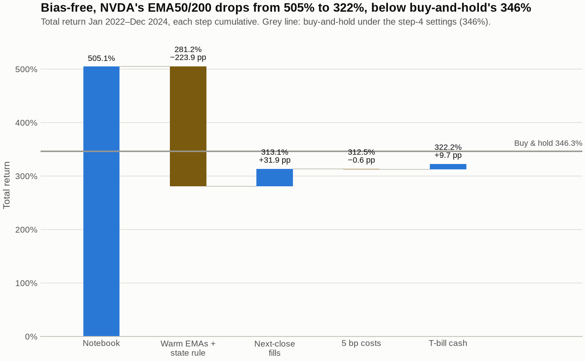
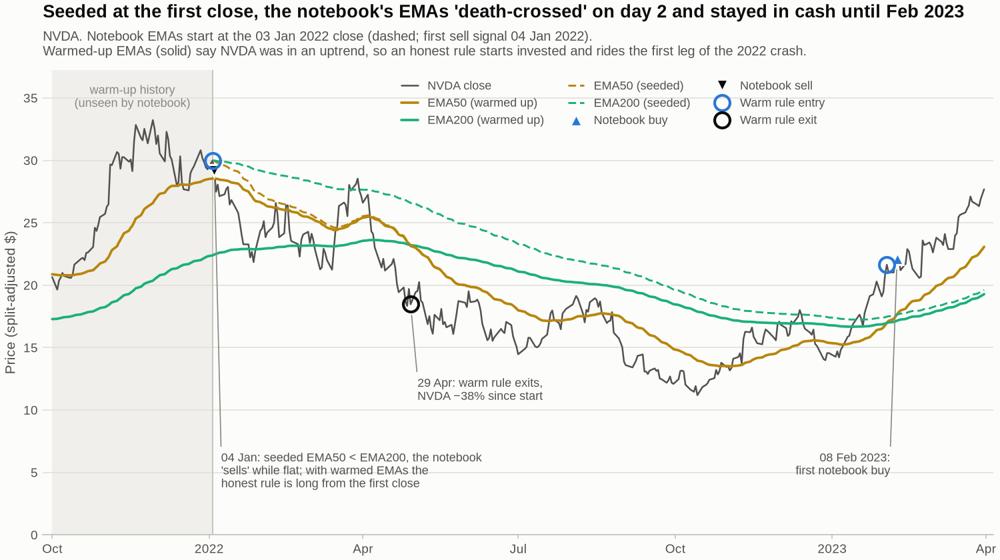
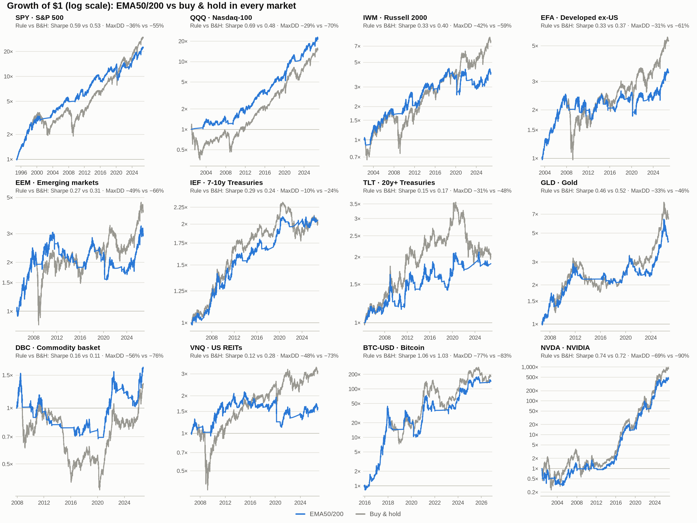
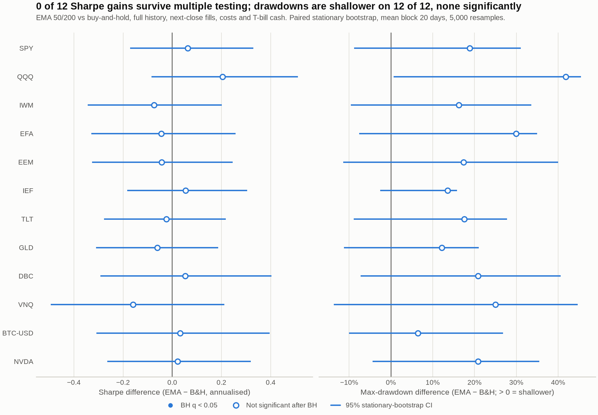
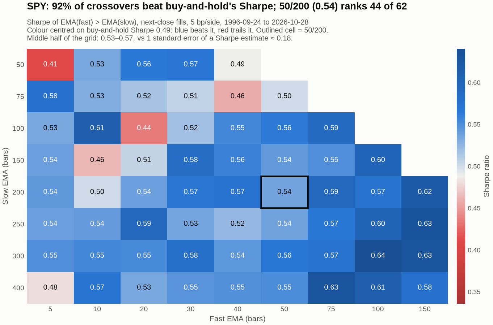
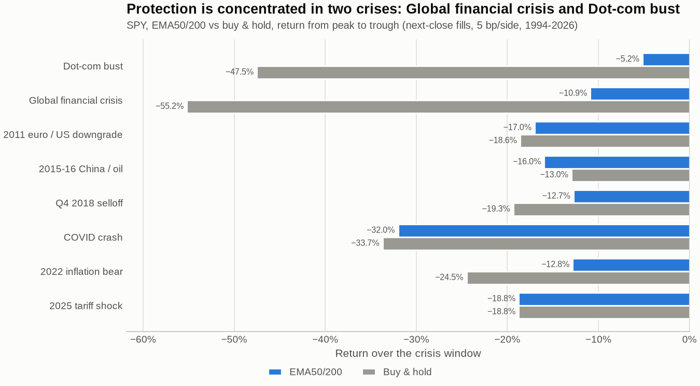
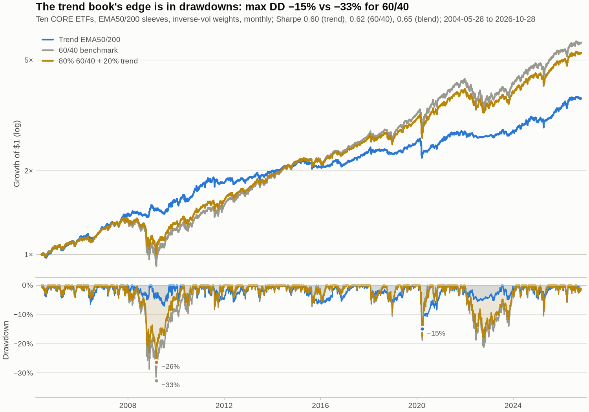

# EMA-Crossover-Backtesting-Engine

[](https://github.com/AshvikMishra/EMA-Crossover-Backtesting-Engine/actions/workflows/ci.yml)

**A bias-aware backtesting engine, and an honest study of what an EMA-crossover trend rule actually does.**

Version 1 of this project was a notebook. It reported that a 50/200-day EMA
crossover on NVIDIA turned $100k into $605k over 2022–2024 (**+505%**), beating
buy-and-hold (**+347%**) with less than half the drawdown. Version 2 rebuilds the
backtester properly and asks how much of that was real. The answer is *none of
the outperformance*. What survives is more interesting and more useful: a
trend rule is a cheap, rules-based **drawdown-control overlay**. It is not a
return enhancer, and it only really works as a *diversified* portfolio.

> Full generated report: [`reports/report.html`](reports/report.html) (download and open it locally: 10 sections, 39 charts).
> Methodology spec: [`docs/METHODOLOGY.md`](docs/METHODOLOGY.md) · Walkthrough notebook: [`notebooks/01_research_walkthrough.ipynb`](notebooks/01_research_walkthrough.ipynb)

---

## TL;DR

| | Finding |
|---|---|
| **The +505% was an artifact** | Warming up the EMAs on prior data and filling trades after the signal turns NVDA 2022–24 into **+322% vs +346%** for buy-and-hold. The original rule only dodged the 2022 crash because its "EMA200" was seeded at the January 2022 price. |
| **Across 12 markets the rule doesn't beat buy-and-hold** | Sharpe is higher on 6 of 12 assets and CAGR on 3 of 12. **None** of the Sharpe differences is statistically significant (paired stationary bootstrap, Holm/BH corrected). |
| **It reliably cuts drawdowns** | Max drawdown is shallower on **12 of 12** assets, by a median of 18 percentage points (SPY: −36% vs −55%). About 73% of that comes simply from holding less of the asset on average. The rest is timing, which pays off in slow bear markets. |
| **Where it helps and where it hurts** | It protected in slow bears (dot-com +42 pp, GFC +44 pp on SPY, the 2021–22 crypto crash +41 pp). It lost in V-shaped crashes: in COVID it sold at the bottom and missed a 44% rebound. |
| **Parameter tuning is noise** | 50/200 sits on a flat Sharpe plateau. The best of 62 configurations has a deflated Sharpe probability of beating buy-and-hold of only 0.03–0.22, and the probability of backtest overfitting is 48–79%. Re-optimising walk-forward *underperforms* a fixed 50/200 out of sample. |
| **Diversified, it's a real diversifier** | A 10-ETF inverse-vol trend book had a −15% max drawdown vs −33% for 60/40. It made **+7% in 2008** (60/40 lost 18%) and lost only 4% in 2022, when stocks *and* bonds fell 15–18%. |

---

## 1. The bias waterfall: how much of +505% was real?



| Step (cumulative) | EMA50/200 | Buy & hold | Max DD (rule) |
|---|---:|---:|---:|
| 0. Original notebook (replicated exactly) | **505.1%** | 346.6% | −27.0% |
| 1. Warm up the EMAs on prior history; position follows the EMA regime, not just the crossing day | 281.2% | 346.6% | −41.4% |
| 2. Fill at the *next* close instead of the signal close | 313.1% | 346.6% | −38.9% |
| 3. Proportional costs, 5 bp per side | 312.5% | 346.3% | −38.9% |
| 4. Idle cash earns the T-bill rate | **322.2%** | **346.3%** | −38.9% |

Two biases combined to create the headline:

1. **EMA warm-up.** An EMA seeds itself with the first price and needs about 461
   bars for EMA200 before the seed's weight falls below 1%. The notebook
   downloaded exactly the test window. Its EMA200 therefore started at NVDA's
   January 2022 high, the EMAs "death-crossed" on day 2, and the rule sat in cash
   through the 2022 crash by accident. With properly warmed EMAs, NVDA was in a
   strong uptrend on 1 January 2022, so an honest rule starts invested and
   rides the first −38% leg down.
2. **Event-only entries.** The notebook only bought on the crossing day itself.
   That is harmless on its own (+519%), but combined with the seeding it
   decided the outcome.



Same-bar execution turns out not to be the culprit here. Next-close fills were
*luckier* than same-close fills in this window, which is itself a lesson:
over two trades, timing noise swamps everything. The paired bootstrap 95% CI
for the Sharpe difference is **[−0.57, +0.76]**. Applied to NVDA's full
2000–2026 history, the rule earns a 26.6% CAGR vs 30.0% for buy-and-hold, with a
−69% vs −90% max drawdown. Picking NVDA at all, the best large-cap of the era,
is a selection bias that no in-sample statistic sees.

## 2. Across 12 markets: drawdown control, not alpha

The universe is fixed in advance: one liquid ETF per asset class (US large,
tech and small caps; developed and emerging ex-US; 7–10y and 20y+ Treasuries; gold;
commodities; REITs), plus Bitcoin and NVDA.



<details><summary>Full cross-asset table (next-close fills, 5 bp / 15 bp for BTC, T-bill cash)</summary>

| Asset | Years | Rule CAGR | Rule Sharpe | Rule MaxDD | B&H CAGR | B&H Sharpe | B&H MaxDD | Time in market | Trades/yr |
|---|---:|---:|---:|---:|---:|---:|---:|---:|---:|
| SPY | 31.9 | 10.3% | 0.59 | −36.3% | 11.2% | 0.53 | −55.2% | 81% | 0.41 |
| QQQ | 25.8 | 12.8% | 0.69 | −28.6% | 11.1% | 0.48 | −70.4% | 78% | 0.43 |
| IWM | 24.5 | 5.9% | 0.32 | −42.4% | 8.7% | 0.40 | −58.6% | 73% | 0.69 |
| EFA | 23.3 | 5.4% | 0.32 | −31.1% | 7.5% | 0.37 | −61.0% | 75% | 0.64 |
| EEM | 21.7 | 5.2% | 0.27 | −49.1% | 6.8% | 0.31 | −66.4% | 68% | 0.74 |
| IEF | 22.4 | 3.3% | 0.29 | −10.4% | 3.2% | 0.23 | −23.9% | 72% | 0.67 |
| TLT | 22.4 | 2.9% | 0.14 | −30.8% | 3.3% | 0.17 | −48.4% | 60% | 0.85 |
| GLD | 20.1 | 7.5% | 0.45 | −33.4% | 9.8% | 0.51 | −45.6% | 70% | 0.65 |
| DBC | 18.9 | 2.7% | 0.16 | −55.5% | 1.6% | 0.10 | −76.4% | 52% | 0.90 |
| VNQ | 20.2 | 2.3% | 0.12 | −48.1% | 5.8% | 0.28 | −73.1% | 71% | 0.79 |
| BTC-USD | 10.9 | 58.1% | 1.06 | −77.0% | 61.6% | 1.03 | −83.4% | 68% | 0.83 |
| NVDA | 25.9 | 26.6% | 0.74 | −68.9% | 30.0% | 0.72 | −89.7% | 71% | 0.54 |

</details>

The pattern matches the trend-following literature (Faber 2007; Zakamulin 2014). The rule spends about 70% of its time in the market, gives up 1–3% of CAGR a
year, and roughly halves the worst drawdown. Its monthly up-capture (65%)
and down-capture (62%) are almost symmetric. That is the signature of
*holding less*, not of *timing well*: an exposure-matched static mix of the
asset and T-bills explains a median 73% of the drawdown reduction.

## 3. Is any of it statistically real?



* **Sharpe difference vs buy-and-hold.** 0 of 12 assets are significant, even before multiple-testing correction. The median 95% CI is 0.58 Sharpe wide, against a median absolute gap of about 0.05.
* **SPY** (32 years of data): the paired probabilistic Sharpe ratio for "rule Sharpe > buy-and-hold Sharpe" is 0.68. The minimum track record needed to confirm the observed gap at 95% is **about 380 years**.
* **QQQ's** standout +0.20 Sharpe gap comes entirely from January 2001 to November 2002: the rule returned +5% while buy-and-hold fell 55%. From late 2002 onward the gap is 0.00.
* **Timing vs chance.** A random-entry Monte Carlo keeps the rule's trade count, holding periods and exposure but places the trades at random. It rejects random timing for 1 of 12 assets before correction and 0 after.
* **Lower volatility** is the one significant effect, on 12 of 12 assets. That is close to mechanical, since the rule spends about 30% of the time in cash.

## 4. Overfitting: the parameter plateau



A 62-cell grid (fast 5–150 × slow 50–400) on SPY, QQQ and BTC:

* **50/200 is unremarkable.** It ranks 44th of 62 on SPY, 10th on QQQ and 32nd on BTC. The middle half of the SPY grid spans only 0.53–0.57 Sharpe, inside one standard error (≈0.18).
* **The deflated Sharpe ratio** (Bailey & López de Prado 2014) gives the *best* cell a probability of only 0.22 (SPY), 0.03 (QQQ) and 0.20 (BTC) of beating buy-and-hold once the 62 trials are accounted for.
* **Probability of backtest overfitting** (CSCV, Bailey et al. 2017): 76% for SPY, 79% for QQQ and 48% for BTC. In most splits the in-sample winner falls below the median out of sample.
* **v1's BTC tuning story** (EMA12/128 → 50/200 "improved" the result) was moving between two noise-level points on this surface.
* **Walk-forward** (5-year train, 1-year test, parameters frozen each test year): re-optimising changed the chosen pair at 35 of 58 fold boundaries. It underperformed a fixed, a-priori 50/200 on average (−0.09 Sharpe), and no difference was significant.

## 5. Where the edge comes from: slow bears vs V-shapes



| SPY episode | Buy & hold | EMA50/200 | What happened |
|---|---:|---:|---|
| Dot-com bust 2000–02 | −47.5% | −5.2% | Exited Oct 2000, re-entered May 2003 |
| Global financial crisis 2007–09 | −55.2% | −10.9% | Exited Jan 2008 |
| 2022 inflation bear | −24.5% | −12.8% | Exited May 2022, re-entered Feb 2023 |
| COVID crash 2020 | −33.7% | −32.0% | Exited *at the bottom* (23 Mar), re-entered June: missed a 44% rebound |
| 2025 tariff shock | −18.8% | −18.8% | Too fast to react; sold after the low |

A 50/200 rule is a ~124-day mean-lag filter on past returns. Its implied kernel is
almost identical to 12-month time-series momentum (Levine & Pedersen 2016),
and it holds the same position as the other trend rules 86% of the time. It can
only help when a decline lasts longer than its lag. Slow, grinding bear
markets are where trend following earns its keep. V-shaped crashes are where
it pays the premium, through whipsaw and late re-entry.

## 6. The right way to use it: a diversified trend sleeve



Ten ETFs, an EMA50/200 sleeve on each, inverse-volatility weights, monthly rebalance, 2004–2026:

| Portfolio | CAGR | Vol | Sharpe | Max DD | 2008 | 2022 |
|---|---:|---:|---:|---:|---:|---:|
| Trend book (EMA50/200 sleeves) | 6.0% | 7.0% | 0.60 | **−15.0%** | **+7.2%** | **−3.9%** |
| Trend book (TSMOM 12M sleeves) | 6.4% | 7.1% | 0.65 | −12.7% | +8.4% | −4.1% |
| 60/40 SPY/IEF | 8.2% | 10.5% | 0.62 | −32.6% | −18.0% | −16.7% |
| 80% 60/40 + 20% trend | 7.7% | 9.3% | 0.65 | −26.3% | −13.4% | −14.1% |

* **Diversification does the work.** The average single sleeve has a Sharpe of 0.32. The diversified book reaches 0.60 with a third of SPY's volatility. Holding the same inverse-vol book permanently long gets 0.62, so the signal's own contribution to Sharpe is nil; its contribution is the drawdown (−15% vs −25%). This matches Moskowitz, Ooi & Pedersen (2012) and Hurst, Ooi & Pedersen (2017).
* **2022 is the key case.** It was a year when the stock–bond hedge failed and 60/40 lost 16.7%. The trend book lost 3.9%: its bond sleeves were flat for the whole year, the commodity sleeve made money, and on average 77% of the book sat in T-bills.
* **It is not a free lunch.** Its Sharpe is statistically indistinguishable from 60/40 (p = 0.55). Vol targeting helps equities slightly, consistent with the leverage effect (Harvey et al. 2018), but no change is significant.

## 7. Costs and execution are *not* the problem

* **Turnover is tiny.** The rule makes 0.4–0.9 round trips a year, so 5 bp per side costs a median **7 bp a year**. Even at 20 bp per side, Sharpe drops by at most 0.02.
* **Break-even costs are high.** Against T-bills they range from 101 bp per side (TLT) to over 3,000 bp (Bitcoin), with a median of 381 bp.
* **Fill timing barely matters.** Same-close vs next-close changes Sharpe by a median of −0.007 for this slow rule. It matters more for fast rules: on EMA5/20 the same-close premium is +0.012 Sharpe.

---

## What this project demonstrates

* **Backtest hygiene.** It covers next-bar execution, indicator warm-up, total-return data, T-bill cash, proportional costs and matched windows. Each one is backed by a test (`tests/`: look-ahead perturbation tests, timing tests, cost invariants, warm-up invariance), and the vectorised engine is cross-checked against an independent event-driven engine to within 1e-10.
* **Statistical honesty.** It uses the probabilistic and deflated Sharpe ratios, PBO via CSCV, stationary bootstrap tests, random-entry Monte Carlo, Holm/BH corrections and walk-forward validation, all implemented from the papers.
* **Market intuition.** Trend following is framed as a lagged filter on momentum (a synthetic long put / long-straddle profile). The study explains why it fails in V-shaped crashes, why the stock–bond correlation in 2022 made trend valuable, and why diversification across assets, not parameter choice, is the source of its Sharpe.

## Repository layout

```
src/trendlab/
  data.py            Yahoo/FRED loaders with a parquet cache (offline-reproducible)
  indicators.py      EMA/SMA + warm-up lengths
  strategies.py      MA crossover (+hysteresis), Faber 10M, TSMOM, Donchian, vol-target overlay
  engine.py          vectorised backtester: same-close / next-open / next-close, bps costs, T-bill cash
  event_engine.py    bar-by-bar engine (integer shares, $ commissions) + exact v1 notebook replica
  metrics.py         CAGR, Sharpe, Sortino, Calmar, drawdowns, alpha/beta, trade stats
  stats.py           PSR, MinTRL, DSR, PBO/CSCV, stationary bootstrap, random-entry test, Lo (2002)
  costs.py           Corwin-Schultz spread estimator, cost sweeps, break-even costs
  validation.py      parameter grids, leakage-free walk-forward optimisation
  regimes.py         crisis tables, lagged regime labels, capture ratios, convexity smile
  portfolio.py       multi-asset trend portfolios, 60/40 and static-mix benchmarks
  plotting.py        consistent chart library;  report.py: self-contained HTML report
  experiments/       the 10 studies above (e01 … e10) + runner
  cli.py             `trendlab` command line
tests/               ~290 tests, offline, < 10 s
data/raw/            cached daily prices (12 assets + VIX) and FRED DTB3
reports/             generated report.html, figures/, tables/ (CSV + Markdown), results.json
notebooks/           00_original_exploration (v1, archived) · 01_research_walkthrough
docs/METHODOLOGY.md  exact conventions and formulas
```

## Quickstart

```bash
python -m venv .venv && source .venv/bin/activate
pip install -e ".[dev]"

trendlab backtest SPY                                  # EMA50/200 vs buy & hold, default realistic settings
trendlab backtest NVDA --start 2022-01-01 --end 2025-01-01 --execution same_close
trendlab backtest QQQ --fast 20 --slow 100 --band 0.02 --bps 10
trendlab list                                          # the 10 experiments
trendlab run                                           # re-run everything (~90 s) -> reports/report.html
trendlab run e01 e03 --quick                           # a subset, fast
trendlab fetch --refresh                               # refresh the data cache from Yahoo/FRED
pytest                                                 # offline test-suite
```

```python
from trendlab import EMACrossover, BuyAndHold, BacktestConfig, CostModel, run_backtest
from trendlab.data import load_prices, risk_free_yield

px, rf = load_prices("SPY"), risk_free_yield()
cfg = BacktestConfig(execution="next_close", costs=CostModel())      # 5 bp per side
res = run_backtest(px, EMACrossover(50, 200), cfg, rf)
bnh = run_backtest(px, BuyAndHold(), BacktestConfig(start=res.start), rf)
print(res.summary(bnh))
```

## Limitations

* **Free data.** Yahoo adjusted prices are not point-in-time. ETFs limit history to about 20–30 years, and Bitcoin to 2014 onwards.
* **No modelling of** taxes (a real cost for a rule that realises gains), short-borrow fees, intraday stops, or market impact beyond a linear bps charge.
* **One history.** A few dozen bear markets is a small sample. The tests above say so explicitly; treat every point estimate as having wide error bars.

## References

* Bailey, D. & López de Prado, M. (2012). The Sharpe Ratio Efficient Frontier. *Journal of Risk*.
* Bailey, D. & López de Prado, M. (2014). The Deflated Sharpe Ratio. *Journal of Portfolio Management*.
* Bailey, D., Borwein, J., López de Prado, M. & Zhu, Q. (2017). The Probability of Backtest Overfitting. *Journal of Computational Finance*.
* Corwin, S. & Schultz, P. (2012). A Simple Way to Estimate Bid-Ask Spreads from Daily High and Low Prices. *Journal of Finance*.
* Faber, M. (2007). A Quantitative Approach to Tactical Asset Allocation. *Journal of Wealth Management*.
* Fung, W. & Hsieh, D. (2001). The Risk in Hedge Fund Strategies: Theory and Evidence from Trend Followers. *Review of Financial Studies*.
* Harvey, C., Hoyle, E., Korgaonkar, R., Rattray, S., Sargaison, M. & Van Hemert, O. (2018). The Impact of Volatility Targeting. *Journal of Portfolio Management*.
* Hurst, B., Ooi, Y. H. & Pedersen, L. H. (2017). A Century of Evidence on Trend-Following Investing. *Journal of Portfolio Management*.
* Ledoit, O. & Wolf, M. (2008). Robust Performance Hypothesis Testing with the Sharpe Ratio. *Journal of Empirical Finance*.
* Levine, A. & Pedersen, L. H. (2016). Which Trend Is Your Friend? *Financial Analysts Journal*.
* Lo, A. (2002). The Statistics of Sharpe Ratios. *Financial Analysts Journal*.
* Moreira, A. & Muir, T. (2017). Volatility-Managed Portfolios. *Journal of Finance*.
* Moskowitz, T., Ooi, Y. H. & Pedersen, L. H. (2012). Time Series Momentum. *Journal of Financial Economics*.
* Politis, D. & Romano, J. (1994). The Stationary Bootstrap. *JASA*.
* Zakamulin, V. (2014). The Real-Life Performance of Market Timing with Moving Average and Time-Series Momentum Rules. *Journal of Asset Management*.

## Project history

v1 (see [`notebooks/00_original_exploration.ipynb`](notebooks/00_original_exploration.ipynb)) implemented the EMA crossover, a flat $5 transaction cost, an equity curve and max drawdown in a single notebook. v2 kept its question and replaced the method.

*Not investment advice. Past performance, especially backtested performance, is not indicative of future results.*
